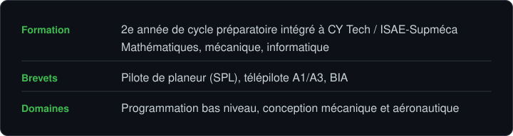
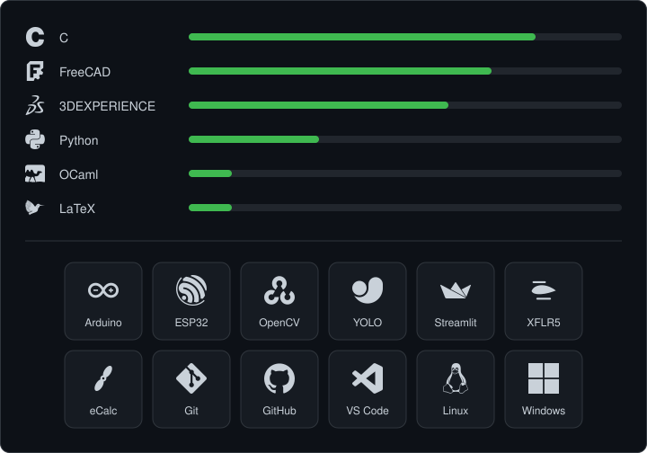

  

  

---

## À propos

  

  <a href="https://ton-lien-portfolio.com">Portfolio</a> · <a href="https://linkedin.com/in/ton-profil">LinkedIn</a>

## Stack

  

## Projets

Cette section est en travaux. Je mettrai bientôt à jour mes différents projets.

## Statistiques

  
  

## Radar

  

