<p align="center">
  
</p>

<p align="center">
  
  
</p>

---

### `IDENT`

```text
CALLSIGN     EliottBDR
NOM          Eliott Boudier
STATUT       Étudiant en prépa intégrée, Supmeca / CY Tech
SPÉCIALITÉS  Informatique · Mécanique · Mathématiques
CAP          Aéronautique
```

---

### `QUALIFICATIONS`

```text
PYTHON         ███░░  Pratique
C              ██░░░  Notions solides
FREECAD        ███░░  Pratique
3DEXPERIENCE   ██░░░  Notions
OCAML          █░░░░  En apprentissage

ÉCHELLE  1 découverte · 2 notions · 3 pratique · 4 aisé · 5 expert
OUTILS   Git · GitHub Actions · VS Code
```

---

### `CARNET DE VOL`

```text
MORVRAN          Drone FPV à voilure fixe, construction en mousse    EN COURS
AVIATION-RADAR   Radar ATC animé généré depuis les stats GitHub      EN SERVICE
FICHE-REVISION   Fiches, quiz et corrections générés depuis un PDF   EN LIGNE
```

- [Morvran](https://github.com/EliottBDR/Morvran) : conception et construction d'un drone, avec suivi des choix et des dépenses
- [aviation-radar](https://github.com/EliottBDR/aviation-radar) : l'outil derrière le radar ci-dessus, utilisable pour n'importe quel profil
- [fiche-revision](https://fiche-revision.streamlit.app) : application web de révision

---

### `FRÉQUENCE`

<p>
  <a href="https://github.com/EliottBDR"></a>
  <a href="https://www.linkedin.com/in/TON-LIEN"></a>
</p>

<sub>`RADAR MIS À JOUR TOUTES LES 6H · GÉNÉRÉ PAR AVIATION-RADAR`</sub>
<sub>`RADAR UPDATED EVERY 6H · GENERATED BY AVIATION-RADAR`</sub>
