<p align="center">
  
</p>

<p align="center">
  
</p>

```python
about = {
    "statut":   "prépa intégrée · Supmeca / CY Tech",
    "domaines": ["informatique", "mécanique", "maths"],
    "cap":      "aéronautique",
    "en_cours": "un drone à voilure fixe",
}
```

<br>

<h3 align="center"><code>QUALIFICATIONS</code></h3>

<p align="center">
  
  
  
  
  
</p>

<p align="center">
  
</p>

<br>

<h3 align="center"><code>CARNET DE VOL</code></h3>

<div align="center">

| [**MORVRAN**](https://github.com/EliottBDR/Morvran) | [**AVIATION-RADAR**](https://github.com/EliottBDR/aviation-radar) | [**FICHE-REVISION**](https://fiche-revision.streamlit.app) |
|:---:|:---:|:---:|
| Drone FPV à voilure fixe, construit en mousse | Radar de contrôle aérien animé, généré depuis les stats GitHub | Fiches, quiz et corrections générés depuis un PDF |
|  |  |  |

</div>

<br>

<h3 align="center"><code>FRÉQUENCE</code></h3>

<p align="center">
  <a href="https://github.com/EliottBDR"></a>
  <a href="https://www.linkedin.com/in/TON-LIEN"></a>
</p>

<br>

<h3 align="center"><code>RADAR</code></h3>

<p align="center">
  
</p>

<p align="center"><sub>Un point = un dépôt récent · distance = ancienneté du dernier commit · couleur = langage<br>Mis à jour toutes les 6 h par aviation-radar</sub></p>


