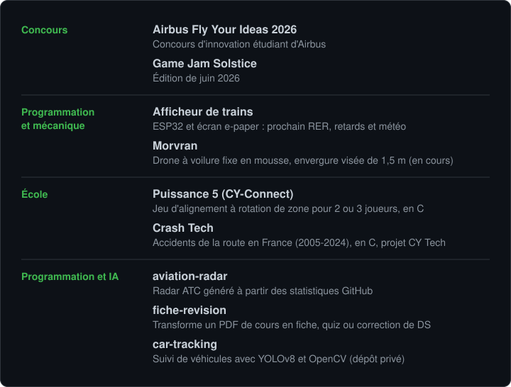

  

  

<h1 align="center">À propos</h1>

  

<h3 align="center">
  <a href="https://ton-lien-portfolio.com">Portfolio</a> &nbsp;·&nbsp; <a href="https://linkedin.com/in/ton-profil">LinkedIn</a>
</h3>

<h1 align="center">Stack</h1>

  

<h1 align="center">Projets</h1>

  
  

  

<h1 align="center">À propos</h1>

  

<h3 align="center">
  <a href="https://ton-lien-portfolio.com">Portfolio</a> &nbsp;·&nbsp; <a href="https://linkedin.com/in/ton-profil">LinkedIn</a>
</h3>

<h1 align="center">Stack</h1>

  

<h1 align="center">Projets</h1>

  

<h3 align="center">
  <a href="https://github.com/EliottBDR/aviation-radar">aviation-radar</a>
  &nbsp;·&nbsp; <a href="https://github.com/EliottBDR/fiche-revision">fiche-revision</a>
  &nbsp;·&nbsp; <a href="https://fiche-revision.streamlit.app">site fiche-revision</a>
  <!-- LIENS À AJOUTER PLUS TARD : sur la ligne du projet voulu, enlève le marqueur d'ouverture et le marqueur de fermeture du commentaire (début et fin de ligne), puis remplace ADRESSE par l'adresse du dépôt. Pas de lien vers un dépôt privé (erreur 404 pour les visiteurs). -->
  <!-- &nbsp;·&nbsp; <a href="ADRESSE">Puissance 5</a> -->
  <!-- &nbsp;·&nbsp; <a href="ADRESSE">Crash Tech</a> -->
  <!-- &nbsp;·&nbsp; <a href="ADRESSE">Afficheur de trains</a> -->
  <!-- &nbsp;·&nbsp; <a href="https://github.com/EliottBDR/Morvran">Morvran</a> -->
</h3>

<h1 align="center">Statistiques</h1>

  
  

<h1 align="center">Radar</h1>

  

" alt="Projets. Concours : Airbus Fly Your Ideas 2026, Game Jam Solstice (juin 2026). Programmation et mécanique : afficheur de trains (ESP32 et écran e-paper), Morvran (drone à voilure fixe en mousse, en cours). École : Puissance 5 (CY-Connect, jeu d'alignement à rotation de zone, en C), Crash Tech (statistiques sur les accidents de la route, en C). Programmation et IA : aviation-radar, fiche-revision, car-tracking." width="720" />

<h3 align="center">
  <a href="https://github.com/EliottBDR/aviation-radar">aviation-radar</a>
  &nbsp;·&nbsp; <a href="https://github.com/EliottBDR/fiche-revision">fiche-revision</a>
  &nbsp;·&nbsp; <a href="https://fiche-revision.streamlit.app">site fiche-revision</a>
  <!-- LIENS À AJOUTER PLUS TARD : sur la ligne du projet voulu, enlève le marqueur d'ouverture et le marqueur de fermeture du commentaire (début et fin de ligne), puis remplace ADRESSE par l'adresse du dépôt. Pas de lien vers un dépôt privé (erreur 404 pour les visiteurs). -->
  <!-- &nbsp;·&nbsp; <a href="ADRESSE">Puissance 5</a> -->
  <!-- &nbsp;·&nbsp; <a href="ADRESSE">Crash Tech</a> -->
  <!-- &nbsp;·&nbsp; <a href="ADRESSE">Afficheur de trains</a> -->
  <!-- &nbsp;·&nbsp; <a href="https://github.com/EliottBDR/Morvran">Morvran</a> -->
</h3>

<h1 align="center">Statistiques</h1>

  
  

<h1 align="center">Radar</h1>

  

